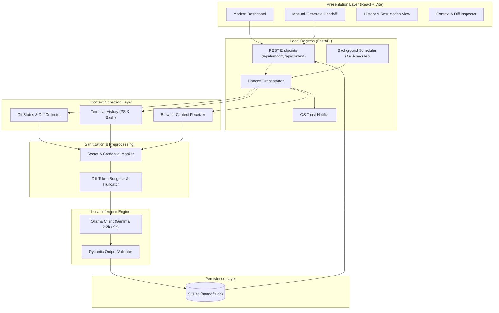

# Tomorrow-Me Handoff (ReMind)

[](https://fastapi.tiangolo.com)
[](https://react.dev)
[](https://vitejs.dev)
[](https://ollama.ai)
[](https://python.org)
[](https://opensource.org/licenses/MIT)

> **Stop losing morning momentum.**  
> An intelligent, privacy-first developer daemon and dashboard that inspects your end-of-day Git diffs, terminal history, and research tabs to synthesize a grounded 7-section resumption brief with local Gemma 2 AI. Zero cloud leakage.

---

## Key Features

- **Local-First Privacy & Zero Cloud Leak**:
  - All inference runs directly on your hardware via local [Ollama](https://ollama.ai/) (`gemma2:2b` or `gemma2:9b`).
  - No source code, diffs, or terminal history leaves your machine.
- **Built-in Secret Scrubber & Token Budgeter**:
  - Automatically identifies and masks API keys (OpenAI, AWS, GitHub PATs, private keys, database passwords, and OAuth tokens).
  - Intelligently truncates large diffs to avoid context window blowup while prioritizing high-signal application files over lockfiles.
- **Multi-Source Context Aggregation**:
  - **Git**: Branch, porcelain file status (staged, unstaged, untracked), diff stats, uncommitted diffs, and recent commits.
  - **Terminal**: Recent command history from Windows PowerShell (`ConsoleHost_history.txt`) and Bash/Zsh (`~/.bash_history`).
  - **Browser**: Opt-in active tab titles and URLs for reference documentation and research tracking.
- **Grounded 7-Section Handoff Schema (FR-06)**:
  - Generates strictly typed, anti-hallucinatory notes:
    1. **Current task**: What was actively being developed.
    2. **Progress**: Specific modifications and accomplishments.
    3. **Current state**: Working components vs. work-in-progress.
    4. **Blockers**: Known errors, failing tests, or hurdles.
    5. **Likely problem areas**: Evidence-backed hypotheses paired with quoted evidence.
    6. **Next steps**: Prioritized, actionable checklist to resume work.
    7. **Relevant context**: Touched files and immediate resume commands.
- **End-of-Day Automation & Notifications (FR-07)**:
  - Background scheduler (`APScheduler`) automatically triggers at your configured end-of-day time.
  - Native Windows 10/11 toast notifications (`Windows.UI.Notifications`) alert you when tomorrow's note is ready.
  - Graceful offline recovery checks if you missed a scheduled run while your device was sleeping or powered off.
- **Modern Glassmorphic Dashboard (React + Vite)**:
  - Dark-mode developer cockpit with interactive checklist, context inspector drawer, search/filter history, and one-click Markdown clipboard export.

---

## System Architecture



---

## Getting Started

### 1. Prerequisites
- **Python 3.10+** (Tested on Python 3.11)
- **Node.js 18+** & `npm`
- **[Ollama](https://ollama.ai/)** running locally:
  ```bash
  ollama run gemma2:2b
  ```

### 2. Backend Daemon Setup
```bash
# Navigate to backend
cd backend

# Create and activate virtual environment
python -m venv venv
# On Windows:
.\venv\Scripts\activate
# On Linux/macOS:
source venv/bin/activate

# Install dependencies
pip install -r requirements.txt

# Create your .env file
cp .env.example .env

# Start FastAPI Daemon
uvicorn app.main:app --reload --port 8000
```
- API Documentation (Swagger): `http://127.0.0.1:8000/docs`
- Health Check: `http://127.0.0.1:8000/health`

### 3. Frontend Dashboard Setup
```bash
# In a new terminal window
cd frontend

# Install dependencies
npm install

# Start Vite dev server
npm run dev
```
Open **`http://localhost:5173`** in your browser to view the dashboard.

---

## Configuration (`.env`)

| Variable | Default | Description |
| :--- | :--- | :--- |
| `HOST` | `127.0.0.1` | Local daemon bind host |
| `PORT` | `8000` | Local daemon port |
| `DEBUG` | `True` | Debug mode |
| `OLLAMA_BASE_URL` | `http://localhost:11434` | Ollama inference API endpoint |
| `OLLAMA_MODEL` | `gemma2:2b` | Target Gemma model (`gemma2:2b`, `gemma2:9b`) |
| `DATABASE_URL` | `sqlite:///./handoffs.db` | SQLite persistence connection URI |
| `SCHEDULED_TIME` | `18:00` | Daily 24h cron time for end-of-day handoff |
| `AUTO_GENERATE_SCHEDULE` | `false` | Enable automated hands-free trigger |

---

## Testing

The repository includes comprehensive automated test suites for security, context collectors, database persistence, and AI prompt grounding:

```bash
cd backend
python -m pytest test_phase2.py test_phase4.py test_phase6.py test_security.py test_ai_benchmark.py
```
- `test_phase2.py`: Git status parsing, terminal history parsing, diff truncation, and secret scrubbing.
- `test_phase3.py`: Schema validation, prompt generation, and live Ollama inference.
- `test_phase4.py`: SQLModel SQLite persistence, database migrations, and CRUD endpoints.
- `test_phase6.py`: Scheduler execution, duplicate daily run prevention, and desktop toast notifications.
- `test_security.py`: 100% test vectors for AWS, GitHub, OpenAI keys, connection strings, and private keys.
- `test_ai_benchmark.py`: Context ground tests simulating broken test suites, mid-refactor states, and clean working trees.

---

## Docker & Render Deployment (Optional)

To containerize or deploy the shared dashboard on Render:

```bash
# Build Docker container
docker build -t remind-handoff .

# Run container
docker run -p 8000:8000 remind-handoff
```

The repository includes a ready-to-deploy [`render.yaml`](./render.yaml) blueprint defining both static frontend and backend services.

---

## License

MIT (c) [Samar-365](https://github.com/Samar-365)
